**My Work:**

## Hi, I'm Zain 👋

I'm an AI Engineer and a 2026 Electrical Engineering graduate from NUST in Islamabad. I build AI products from start to finish: the data and the model, the backend, and a frontend that people can actually use.

Most of what I build is for problems I've seen around me in Pakistan: families who can't check their electricity bills, farmers guessing at crop diseases, people who hear a section of the Penal Code at a police station and have no way to read it. I test everything on real-world data before calling it done, and I write up what didn't work as well as what did.

**Open to:** AI Engineer, ML Engineer, Applied AI / LLM Engineer and Forward Deployed Engineer roles, on-site or remote.

---

## At a glance

| Project | What it does | Best result |
| :--- | :--- | :--- |
| **Earshot** | Answers questions about podcasts and plays the exact second each quote was said | Reranking raised top-5 search accuracy from **76% to 93%** |
| **Dehqan** | Diagnoses crop disease from a leaf photo, and says "not sure" when it is | Real-farm accuracy raised from **12% to 62%** |
| **Rehnuma** | Reads and re-checks Pakistani electricity bills in Urdu or English | **96%** of bill fields read correctly, with no invented numbers |
| **Parity** | Checks whether a website works for people with disabilities | Vision-model precision raised from **80% to 100%** |
| **EdgarIQ** | Answers financial questions from SEC filings with citations | Test pass rate from **29% to 100%** after fixing retrieval |
| **Final-year project** | Classifies passing vehicles from underground sensors | Accuracy from **71% to 99%** through feature design |

Every project has its own accuracy page with the test data and its limits.

---

## What I've built

### 🎙️ [Earshot](https://github.com/MoZainUlAbideen/Earshot): ask a podcast a question

You ask a question across several podcasts and get a short answer where every quote links to the exact second it was said; one click plays the original audio. I compared keyword, semantic and reranked search on a test set I wrote. The reranker was the most accurate but too slow for the free server, so the live site runs the faster version and says so. A plain-code checker matches every quote against the transcript, and if the model can't back up an answer, Earshot says it couldn't find one.

**Under the hood:** Whisper transcripts with word-level timestamps · keyword and vector search in one Postgres database · a Postgres job queue for transcription · CI against a real pgvector database

`Python` `Whisper` `PostgreSQL + pgvector` `FastAPI` `Next.js`

### 🌾 [Dehqan](https://github.com/MoZainUlAbideen/Dehqan): a crop doctor that admits when it isn't sure

A farmer sends a photo of a sick leaf and Dehqan names the likely disease, grades how bad it is, and suggests safe hours to spray from a live forecast, in Urdu or English, by text or voice. My first model looked great on lab photos but failed on real farm photos, so I rebuilt it on CLIP with field data. When it isn't confident, it says so and points the farmer to the local extension office, and it refuses every pesticide-dose question.

**Under the hood:** a CLIP check that rejects photos that aren't leaves · a segmentation model that measures how much of the leaf is diseased · models converted to ONNX to fit a 512 MB free server, checked against the originals on 1,000 photos

`Python` `PyTorch` `CLIP` `ONNX` `FastAPI` `Next.js`

### ⚡ [Rehnuma](https://github.com/MoZainUlAbideen/rehnuma): an electricity bill assistant

Reads a photo of a Pakistani electricity bill, re-checks every charge with its own calculator, and explains the bill in plain Urdu or English. The AI reads the bill and writes the explanation, but it never does the maths. It also answers NEPRA regulation questions with the exact clause. Solar and non-solar households in Peshawar tested the Urdu summaries.

**Under the hood:** a re-read loop when the numbers don't add up · Urdu questions rewritten into the regulations' English wording before search · evaluation checks that fail the build if a metric drops · Langfuse tracing with personal numbers masked

`Python` `FastAPI` `Gemini` `Groq` `Next.js` `Langfuse`

### ♿ [Parity](https://github.com/MoZainUlAbideen/Parity): a web accessibility auditor

Opens a website in a real browser and checks whether people with disabilities can use it, combining standard WCAG rules with a vision model that judges whether image descriptions make sense. The vision model kept flagging correct descriptions as wrong, so I added a consistency check that removed those false alarms.

**Under the hood:** headless Chromium on desktop and mobile · a pixel-level contrast meter and a keyboard-navigation check · a job queue with rate limits and protection against malicious URLs

`Python` `FastAPI` `Playwright` `axe-core` `Gemini`

### 📈 [EdgarIQ](https://github.com/MoZainUlAbideen/Edgar_iq): questions over SEC filings

Answers multi-year financial questions from company filings with citations. Early on it kept quoting figures from the wrong quarter; I traced that back to the search step and fixed it with date-aware retrieval.

`Python` `Groq` `FastAPI` `RAG`

### 📡 [Underground vehicle classifier](https://github.com/MoZainUlAbideen/Underground_Vehicle_Detection_System-FYP-): final-year project

A buried sensor node (ESP32-S3 and Raspberry Pi) that tells light vehicles, heavy vehicles and an empty road apart from vibration, magnetic and acoustic signals. I collected the data outdoors, designed the features and wrote the method up as an IEEE-format paper.

`ESP32-S3` `Raspberry Pi` `Python` `scikit-learn`

<b>More projects</b>

 

- [**Dafa**](https://github.com/MoZainUlAbideen/Dafa) ([live](https://dafa-ten.vercel.app/)): Pakistan's Constitution and Penal Code in English, Urdu or Roman Urdu, with every cited section checked against the official text.
- [**GPU Scout**](https://github.com/MoZainUlAbideen/GPU_Scout_with_memory): GPU recommendations from a team of expert agents with memory.
- [**Job Assistant**](https://github.com/MoZainUlAbideen/Job-Assistant-An-AI-Resume-Fit-Dashboard-Built-From-Scratch-FastAPI-Groq-RAG): scores how well a resume fits a job and shows the skill gaps.
- [**Production-RAG**](https://github.com/MoZainUlAbideen/Production-RAG): my RAG notebook, including a login-gated demo with role-based access.
- Computer vision: [Car Crash Detection](https://github.com/MoZainUlAbideen/Car-Crash-detection-using-yolov8) · [Parking Slots](https://github.com/MoZainUlAbideen/Parking-slot-detection-using-Computer-Vision) · [Hand Gestures](https://github.com/MoZainUlAbideen/Hand_Gestures_Recognition) · [Face Blurring](https://github.com/MoZainUlAbideen/FaceRecognition-and-Blurring)
- Earlier ML: [E-commerce Recommender](https://github.com/MoZainUlAbideen/Ecommerce_Recomendation_system_Machine_Learning) · [Movie Recommender](https://github.com/MoZainUlAbideen/Movies_Recommendation_Using_Python_System) · [Fake News Prediction](https://github.com/MoZainUlAbideen/Fake_News_Prediction) · [DSA in Python](https://github.com/MoZainUlAbideen/DSA_Python)

---

## Experience

**Machine Learning Engineer Intern**, RISETech, Islamabad · *Jun – Aug 2025* 
Collected sensor data in the field and designed the features for the vehicle classifier above.

**AI Engineer Intern**, Software Productivity Strategists (SPS), NSTP, Islamabad · *Jun – Aug 2024* 
Built Python backend features for two company products and deployed AI features on Microsoft Azure.

Also: freelance backend work on Upwork, and I lead the collaborations team at WWF-Pakistan as a volunteer.

---

## Tools I use

Also: Whisper, CLIP, Hugging Face, ONNX Runtime, pgvector, Gemini, Groq, Langfuse, Playwright and pytest. I build with Claude Code every day, and I check what it writes with tests and evaluations before I trust it.

**Certifications:** Google AI Professional · Advanced ML on Google Cloud · IBM Machine Learning · AWS Cloud Practitioner Essentials

---

## Just for fun

🎮 [**The Arena**](https://m-zain-ul-abideen-portfolio.vercel.app/): drive my toy car around a 3D Rocket League-style football arena and find my work on the podiums. Built from scratch with Three.js. ([source](https://github.com/MoZainUlAbideen/M-Zain-ul-Abideen-Portfolio))

 

